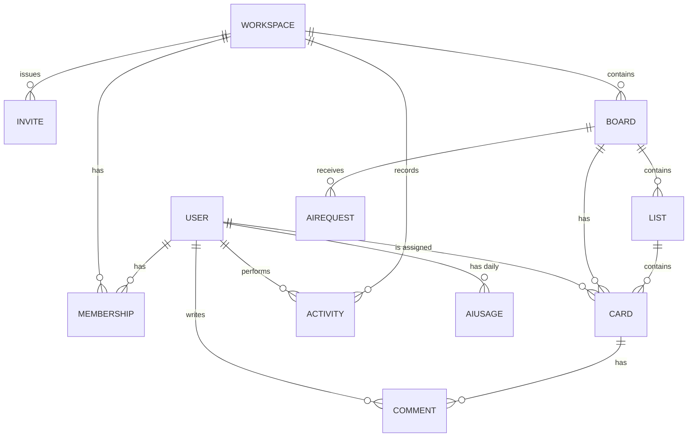

# TeamBoard: Database Schema

> **Status:** Draft v1, for team review
> **Database:** MongoDB (Atlas), accessed with Mongoose
> **Companion documents:** `app_concept.md`, `api.md`

---

## 1. Purpose and how to use this document

This document is the single source of truth for the data model. Every feature owner codes against it, and nobody adds, renames or removes a field without a pull request that updates this file and is approved by the team.

Models and shared types are merged in **one pull request** in week 1 (issue S2), reviewed by all four members, so that features can be built in parallel afterwards.

## 2. Conventions

| Topic | Rule |
|---|---|
| Collection names | Plural, lowercase: `users`, `workspaces`, `memberships` |
| Field names | `camelCase` |
| IDs | MongoDB `ObjectId`. The API returns them as strings named `id`, never `_id`. |
| Timestamps | Every collection has `createdAt` and `updatedAt` (Mongoose `timestamps: true`), except `activities`, which only has `createdAt` |
| Dates and times | Stored in UTC, sent as ISO 8601 strings |
| Due dates | Stored as **text in the format `YYYY-MM-DD`** (see section 12) |
| Text fields | Always trimmed. Every text field has a maximum length, defined in section 13. |
| References | Plain `ObjectId` fields with a `ref`. MongoDB does not enforce them, so **services enforce them** (section 10). |
| Secrets | Passwords and tokens are stored only as hashes. Hash fields use `select: false` and are never returned by the API. |
| Deletes | Hard deletes with explicit cascades in the service layer (section 10). No soft delete in the MVP. |
| Sessions | None stored. Authentication uses stateless JWTs, and `protect` looks the user up on every request. |

## 3. Overview

### 3.1 Collections

| Collection | Purpose | Written by |
|---|---|---|
| `users` | Accounts, roles, blocking, password reset | Auth and admin |
| `workspaces` | A team's home | Workspaces |
| `memberships` | Which user belongs to which workspace, and as what | Workspaces and invites |
| `invites` | Invite links and email invites | Invites |
| `boards` | Projects inside a workspace | Boards |
| `lists` | Columns on a board | Boards |
| `cards` | Tasks | Cards, AI bulk-create |
| `comments` | Messages on cards | Cards |
| `activities` | Immutable history of what happened | Everyone, through one helper |
| `aiusages` | Daily AI counter per user | AI |
| `airequests` | Log of AI breakdown calls (recommended) | AI |

### 3.2 Relationships



### 3.3 Why `workspace` is stored on boards, lists, cards and comments

Every protected route receives the id of a board, list or card. To check permission, the server must find the workspace and then the membership. If each document stores its own `workspace`, that check is always **one lookup of the document plus one lookup of the membership**. The cost is one extra field that never changes after creation. Services must set it from the parent, never from the request body.

## 4. Enumerations

| Name | Values |
|---|---|
| User role | `user`, `admin` |
| Membership role | `owner`, `member` |
| Card source | `manual`, `ai` |
| AI request status | `success`, `provider_error`, `invalid_output`, `limit_reached` |
| Activity type | see section 5.9 |

## 5. Collections

### 5.1 `users`

| Field | Type | Required | Notes |
|---|---|---|---|
| `name` | String | Yes | 2 to 50 characters |
| `email` | String | Yes | Unique, lowercase, valid email |
| `password` | String | Yes | bcrypt hash, `select: false` |
| `role` | String | Yes | `user` (default) or `admin`. **Never settable through sign-up.** Admin accounts are created by the seed script only. |
| `blocked` | Boolean | Yes | Default `false` |
| `blockReason` | String | If blocked | 3 to 300 characters. Shown to the user when they try to sign in. |
| `blockedAt` | Date | If blocked | |
| `blockedBy` | ObjectId to `users` | If blocked | The admin who blocked the account |
| `passwordChangedAt` | Date | No | Set whenever the password changes. Tokens issued before it are rejected. |
| `resetPasswordToken` | String | No | SHA-256 hash of the emailed token, `select: false` |
| `resetPasswordExpires` | Date | No | 15 minutes after the request |
| `lastLoginAt` | Date | No | Updated on each successful sign-in |

**Indexes:** `email` (unique), `createdAt` (descending, for the admin list), `resetPasswordToken` (sparse).

**Rules**
- Unblocking clears `blocked`, `blockReason`, `blockedAt` and `blockedBy`.
- Users are never deleted in the MVP. Other collections can therefore always populate a user's name.

### 5.2 `workspaces`

| Field | Type | Required | Notes |
|---|---|---|---|
| `name` | String | Yes | 2 to 60 characters |
| `description` | String | No | Up to 300 characters |
| `createdBy` | ObjectId to `users` | Yes | The original owner. Informational only. |

**Indexes:** `createdBy`, `createdAt` (descending).

**Rules**
- A workspace always has **exactly one** membership with role `owner`. That membership, not `createdBy`, decides who the owner is.
- Creating a workspace and its owner membership happens together (section 10.1).
- Transferring ownership and deleting a workspace are out of scope for the MVP.

### 5.3 `memberships`

| Field | Type | Required | Notes |
|---|---|---|---|
| `workspace` | ObjectId to `workspaces` | Yes | |
| `user` | ObjectId to `users` | Yes | |
| `role` | String | Yes | `owner` or `member` |
| `joinedAt` | Date | Yes | Default: now |
| `invite` | ObjectId to `invites` | No | The invite used to join. Empty for the owner. |

**Indexes:** `{ workspace, user }` (**unique**, so nobody joins twice), `{ user }` (for "my workspaces"), `{ workspace, role }`.

**Rules**
- This is the **only** place membership is stored. Every permission check reads it.
- The owner's membership cannot be removed.

### 5.4 `invites`

| Field | Type | Required | Notes |
|---|---|---|---|
| `workspace` | ObjectId to `workspaces` | Yes | |
| `tokenHash` | String | Yes | Unique. SHA-256 of a 32-byte random token. The raw token exists only inside the link. |
| `createdBy` | ObjectId to `users` | Yes | Must be the workspace owner |
| `email` | String | No | Lowercase. If set, only an account with this email can accept. |
| `expiresAt` | Date | Yes | Default: 7 days after creation |
| `maxUses` | Number | Yes | Whole number, at least 1. Default 1 for email invites, 10 for link invites. |
| `usesCount` | Number | Yes | Default 0 |
| `revokedAt` | Date | No | Set when the owner cancels the invite |

**Indexes:** `tokenHash` (unique), `{ workspace, createdAt }`, and a **TTL index** on `expiresAt` with `expireAfterSeconds: 2592000`, which removes invites 30 days after they expire.

**Accepting an invite** must be one atomic update, so two people cannot both use the last slot:

```
update where tokenHash matches AND revokedAt is empty AND expiresAt is in the future
       AND usesCount is less than maxUses
set    usesCount = usesCount + 1
```

If it matches nothing, answer with one generic message ("This invite is invalid or has expired"), whatever the reason. Then create the membership. If the membership already exists (duplicate key), the user is already a member, so answer with success and roll the counter back.

### 5.5 `boards`

| Field | Type | Required | Notes |
|---|---|---|---|
| `workspace` | ObjectId to `workspaces` | Yes | Never changes |
| `name` | String | Yes | 1 to 80 characters |
| `description` | String | No | Up to 500 characters |
| `createdBy` | ObjectId to `users` | Yes | |

**Indexes:** `{ workspace, createdAt: -1 }`.

**Rules**
- A new board is created with three lists: **To do** (position 1024), **Doing** (2048) and **Done** (3072, `isDone: true`).
- Only the workspace owner can delete a board.

### 5.6 `lists`

| Field | Type | Required | Notes |
|---|---|---|---|
| `board` | ObjectId to `boards` | Yes | |
| `workspace` | ObjectId to `workspaces` | Yes | Copied from the board |
| `name` | String | Yes | 1 to 50 characters |
| `position` | Number | Yes | See section 11 |
| `isDone` | Boolean | Yes | Default `false`. Marks a "finished" column, used by "overdue" logic and the stretch-goal AI summary. |

**Indexes:** `{ board, position }`, and `{ board, name }` **unique with a case-insensitive collation** (`{ locale: "en", strength: 2 }`).

**Why list names are unique per board:** the AI returns a list **name**, and the server matches it to a real list. If two lists shared a name, the match would be ambiguous.

### 5.7 `cards`

| Field | Type | Required | Notes |
|---|---|---|---|
| `board` | ObjectId to `boards` | Yes | |
| `list` | ObjectId to `lists` | Yes | The list must belong to the same board |
| `workspace` | ObjectId to `workspaces` | Yes | Copied from the board |
| `title` | String | Yes | 1 to 200 characters |
| `description` | String | No | Up to 5000 characters. Default empty string. |
| `dueDate` | String | No | `YYYY-MM-DD`, validated as a real calendar date |
| `assignee` | ObjectId to `users` | No | **One** assignee. Must be a member of the card's workspace. |
| `position` | Number | Yes | Order inside the list (section 11) |
| `createdBy` | ObjectId to `users` | Yes | |
| `createdVia` | String | Yes | `manual` (default) or `ai` |
| `aiBatchId` | String | No | Same value for all cards added from one AI preview |

**Indexes**

| Index | Used for |
|---|---|
| `{ list, position }` | Showing a column in order |
| `{ board }` | Loading a whole board |
| `{ assignee, dueDate }` | "My cards" |
| `{ board, dueDate }` | Overdue and due-today checks |
| `{ createdAt: -1 }` | Admin statistics |

**Rules**
- The AI **never** sets `assignee`.
- The assignee must be a current member of the workspace. When a member is removed, their cards are unassigned (section 10.3).
- Moving a card changes `list` and `position` in one update.

### 5.8 `comments`

| Field | Type | Required | Notes |
|---|---|---|---|
| `card` | ObjectId to `cards` | Yes | |
| `board` | ObjectId to `boards` | Yes | Copied from the card |
| `workspace` | ObjectId to `workspaces` | Yes | Copied from the card |
| `author` | ObjectId to `users` | Yes | |
| `text` | String | Yes | 1 to 2000 characters |

**Indexes:** `{ card, createdAt: 1 }`.

**Rules:** the author can delete their own comment, and the workspace owner can delete any comment. Editing comments is not part of the MVP.

### 5.9 `activities`

An **append-only** history. Documents are never updated, and the only way they disappear is when a whole workspace is removed.

| Field | Type | Required | Notes |
|---|---|---|---|
| `workspace` | ObjectId to `workspaces` | Yes | |
| `board` | ObjectId to `boards` | No | Empty for workspace-level events |
| `card` | ObjectId to `cards` | No | |
| `actor` | ObjectId to `users` | Yes | Who did it |
| `actorName` | String | Yes | **Snapshot** of the name at that moment |
| `type` | String | Yes | One of the types below |
| `meta` | Object | No | Small object with names, never whole documents |
| `createdAt` | Date | Yes | |

**Indexes:** `{ board, createdAt: -1 }`, `{ workspace, createdAt: -1 }`.

**Why names are copied into `meta`:** history must still read correctly after a card, list or board is renamed or deleted. "Rachel moved *Design homepage* to *Doing*" must not become "Rachel moved *[deleted]*".

| Type | Written when | `meta` keys | Sentence shown to the user |
|---|---|---|---|
| `workspace.created` | A workspace is created | `workspaceName` | "{actor} created the workspace" |
| `member.joined` | An invite is accepted | `via` (`invite`) | "{actor} joined the workspace" |
| `member.removed` | The owner removes someone | `memberName` | "{actor} removed {memberName}" |
| `board.created` | A board is created | `boardName` | "{actor} created the board {boardName}" |
| `board.renamed` | A board is renamed | `from`, `to` | "{actor} renamed the board to {to}" |
| `board.deleted` | A board is deleted | `boardName` | "{actor} deleted the board {boardName}" |
| `list.created` | A list is created | `listName` | "{actor} added the list {listName}" |
| `list.renamed` | A list is renamed | `from`, `to` | "{actor} renamed {from} to {to}" |
| `list.reordered` | A list is moved | `listName` | "{actor} moved the list {listName}" |
| `list.deleted` | A list is deleted | `listName` | "{actor} deleted the list {listName}" |
| `card.created` | A card is created, by hand or by AI | `cardTitle`, `listName`, `via`, `batchId` (AI only) | "{actor} added {cardTitle} to {listName}" |
| `card.updated` | Title, description or due date changes | `cardTitle`, `fields` (names only) | "{actor} updated {cardTitle}" |
| `card.moved` | A card changes list | `cardTitle`, `fromList`, `toList` | "{actor} moved {cardTitle} from {fromList} to {toList}" |
| `card.assigned` | An assignee is set | `cardTitle`, `assigneeName` | "{actor} assigned {cardTitle} to {assigneeName}" |
| `card.unassigned` | An assignee is cleared | `cardTitle`, `assigneeName` | "{actor} unassigned {assigneeName} from {cardTitle}" |
| `card.deleted` | A card is deleted | `cardTitle` | "{actor} deleted {cardTitle}" |
| `comment.added` | A comment is posted | `cardTitle` | "{actor} commented on {cardTitle}" |
| `comment.deleted` | A comment is removed | `cardTitle` | "{actor} deleted a comment on {cardTitle}" |

**Decision on AI cards:** each card added from an AI preview writes a normal `card.created` activity with `via: "ai"` and the shared `batchId`. There is no separate summary entry, so the history treats AI cards "like any other card", as the brief requires.

All activity is written through **one helper**, `logActivity(...)`, so every feature records history in the same way. The helper never throws: a failure to write history must not fail the user's action, but it must be logged.

### 5.10 `aiusages`

One document per user per day, used for the daily limit.

| Field | Type | Required | Notes |
|---|---|---|---|
| `user` | ObjectId to `users` | Yes | |
| `date` | String | Yes | `YYYY-MM-DD` in the app time zone |
| `count` | Number | Yes | Breakdowns used today |
| `expireAt` | Date | Yes | 60 days after creation, removed by a TTL index |

**Indexes:** `{ user, date }` (**unique**), and a TTL index on `expireAt`.

**Enforcing the limit atomically**, so two parallel requests cannot both slip past the limit:

```
update where user and date match AND count is less than the limit (10)
set    count = count + 1        (create the document if missing)
```

If that update matches nothing because the count already reached the limit, the unique index makes the "create" part fail with a duplicate key. Treat that as **limit reached** and answer 429. If the AI provider then fails on our side, decrement the counter, so a failed attempt does not cost the user.

### 5.11 `airequests` (recommended)

A short-lived log of AI calls. It is how the team writes the test notes in `docs/ai-tests.md` and debugs strange output.

| Field | Type | Required | Notes |
|---|---|---|---|
| `user` | ObjectId to `users` | Yes | |
| `board` | ObjectId to `boards` | Yes | |
| `workspace` | ObjectId to `workspaces` | Yes | |
| `goal` | String | Yes | Up to 500 characters |
| `deadline` | String | No | `YYYY-MM-DD` |
| `status` | String | Yes | See section 4 |
| `cardsReturned` | Number | No | Cards the model returned |
| `cardsKept` | Number | No | Cards left after validation |
| `fixes` | [String] | No | For example `date_in_past`, `unknown_list`, `trimmed_to_10` |
| `model` | String | No | Provider model name |
| `promptVersion` | String | Yes | Bump it whenever the prompt changes |
| `latencyMs` | Number | No | |
| `expireAt` | Date | Yes | 30 days after creation (TTL index) |

**Privacy:** the goal text can contain private information, so keep the retention short and never expose this collection through the API, except to admins if the team decides so.

## 6. Example documents

**A card created by the AI**

```json
{
  "_id": "665f1c2a9b1e4a0012a3b4c5",
  "workspace": "665f1a000000000000000001",
  "board": "665f1b000000000000000002",
  "list": "665f1b100000000000000003",
  "title": "Collect content for the homepage",
  "description": "Get the school's mission, contact details and 5 photos.",
  "dueDate": "2026-11-12",
  "assignee": null,
  "position": 1024,
  "createdBy": "665f0f000000000000000004",
  "createdVia": "ai",
  "aiBatchId": "b_8f2c1d",
  "createdAt": "2026-11-09T08:30:00.000Z",
  "updatedAt": "2026-11-09T08:30:00.000Z"
}
```

**The matching activity entry**

```json
{
  "workspace": "665f1a000000000000000001",
  "board": "665f1b000000000000000002",
  "card": "665f1c2a9b1e4a0012a3b4c5",
  "actor": "665f0f000000000000000004",
  "actorName": "Fabrice Nsanzamahoro",
  "type": "card.created",
  "meta": {
    "cardTitle": "Collect content for the homepage",
    "listName": "To do",
    "via": "ai",
    "batchId": "b_8f2c1d"
  },
  "createdAt": "2026-11-09T08:30:00.000Z"
}
```

**An email invite**

```json
{
  "workspace": "665f1a000000000000000001",
  "tokenHash": "9c1185a5c5e9fc54612808977ee8f548b2258d31...",
  "createdBy": "665f0f000000000000000001",
  "email": "teammate@example.com",
  "expiresAt": "2026-11-16T08:00:00.000Z",
  "maxUses": 1,
  "usesCount": 0,
  "revokedAt": null
}
```

## 7. Access rules

"Member" means a user with a membership in the card's, list's or board's workspace. Every rule below is enforced **on the server**, in shared middleware. The screens only hide buttons.

| Data | Read | Create and edit | Delete |
|---|---|---|---|
| Own account | The user | The user | Not in the MVP |
| Any account | Admin | Admin (block and unblock only) | Not in the MVP |
| Workspace | Members, admin (list and counts) | Owner (rename) | Not in the MVP |
| Memberships | Members | Through invites, and the owner removes | Owner (not themselves) |
| Invites | Owner | Owner | Owner (revoke) |
| Boards | Members | Members create and rename | **Owner only** |
| Lists | Members | Members | Members |
| Cards | Members | Members | Members |
| Comments | Members | Members | Author, or the owner |
| Activities | Members | The helper only | Nobody |
| AI usage | The user (own count only) | The AI service only | Nobody |

A blocked user is rejected by `protect` before any of these rules run, and a blocked account takes effect immediately because the user is read from the database on every request.

## 8. Query patterns and the indexes behind them

| What the app needs | Query | Index |
|---|---|---|
| Is this user a member of this workspace? | memberships by `{ workspace, user }` | `{ workspace, user }` unique |
| My workspaces | memberships by `{ user }`, then the workspaces | `{ user }` |
| Members of a workspace | memberships by `{ workspace }` | `{ workspace, user }` |
| Boards in a workspace | boards by `{ workspace }`, newest first | `{ workspace, createdAt }` |
| Open a board | lists by `{ board }` ordered by position, plus cards by `{ board }` | `{ board, position }`, `{ board }` |
| A column in order | cards by `{ list }` ordered by position | `{ list, position }` |
| **My cards**, by due date, empty dates last | cards by `{ assignee }` in my workspaces, sorted with empty `dueDate` last | `{ assignee, dueDate }` |
| Comments on a card | comments by `{ card }` oldest first | `{ card, createdAt }` |
| Board activity feed | activities by `{ board }` newest first, paginated | `{ board, createdAt }` |
| Daily AI limit | atomic update on `{ user, date }` | `{ user, date }` unique |
| Overdue cards on a board | cards by `{ board }` with `dueDate` before today, not in a done list | `{ board, dueDate }` |
| **Admin: platform numbers** | see below | various |

**Sorting "My cards".** MongoDB sorts missing dates first when sorting ascending. To put cards without a date last, sort on two keys: first "has no date" (computed with an aggregation `$addFields`), then `dueDate`.

**Admin statistics**

| Number | How |
|---|---|
| Users | Count of `users` |
| Workspaces | Count of `workspaces` |
| Cards created this week | Count of `cards` where `createdAt` is within the **last 7 days** (a rolling week, to keep the definition simple) |
| Cards created by day (optional chart) | Group `cards` by day of `createdAt` for the last 7 days |
| AI breakdowns today (optional) | Sum of `aiusages.count` for today's `date` |

## 9. Limits

These limits protect the database and the interface. The server enforces them, and the forms mirror them.

| Item | Limit |
|---|---|
| Members per workspace | 50 |
| Boards per workspace | 50 |
| Lists per board | 20 |
| Cards per list | 200 |
| Cards created by one AI request | 10 |
| AI goal length | 500 characters |
| Comments per card | 200 |
| Invite lifetime | 7 days (default) |
| AI breakdowns per user per day | 10 |

## 10. Data lifecycle: creating, deleting and cascades

MongoDB does not cascade deletes, so the service layer does it. Where the database supports transactions, wrap the steps in one. Otherwise run them in the order shown and keep every step **safe to repeat**, so a crash in the middle can be fixed by running the operation again.

### 10.1 Creating a workspace
1. Create the `workspaces` document.
2. Create the owner `memberships` document.
3. Write `workspace.created`.

If step 2 fails, delete the workspace again.

### 10.2 Deleting a board (owner only)
1. Delete its `comments`.
2. Delete its `cards`.
3. Delete its `lists`.
4. Delete the `board`.
5. Write `board.deleted` as a **workspace-level** activity, with the board's name in `meta`.

Existing activity for that board is kept. It is no longer reachable through the board's feed, but it still tells the workspace what happened.

### 10.3 Removing a member (owner only)
1. Set `assignee` to empty on every card in that workspace assigned to them, and write `card.unassigned` for each.
2. Delete their `memberships` document.
3. Write `member.removed`.

Their comments and past activity stay, because history must remain readable.

### 10.4 Deleting a list
**Decision (default):** block the delete with a 409 if the list still has cards, unless the request names another list to move them to (`moveCardsTo`). Nothing is lost by accident.

### 10.5 Deleting a card
Delete its comments, then the card, then write `card.deleted` with the title in `meta`.

### 10.6 Blocking a user
No data is deleted or changed except the block fields on the user. Their memberships, cards and comments stay. Cards assigned to them remain assigned.

## 11. Ordering lists and cards (`position`)

`position` is a plain number. New items get `last position + 1024`, which leaves gaps. To insert between two neighbours, use the **midpoint** of their positions.

This means moving one card changes **one document**, instead of renumbering the whole list. If two neighbours get closer than `0.001`, rebalance that list by renumbering it in steps of 1024. Drag and drop (a stretch goal) then needs no database change.

## 12. Why due dates are text

A due date means "this calendar day", not a moment in time. Storing a real `Date` causes off-by-one bugs, because a date saved at midnight in one time zone displays as the previous day in another. A `YYYY-MM-DD` string is the same everywhere, sorts correctly as text, and is exactly what an HTML date input produces.

- **Today** is calculated in the app time zone (`Africa/Kigali`, configurable), not in the server's or the browser's.
- A card is **overdue** when `dueDate` is earlier than today and its list is not marked `isDone`.
- The AI returns `due_in_days`. The server converts it to a `YYYY-MM-DD` string, then applies the rules: not before today, and not after the deadline.

## 13. Validation summary

Validation happens twice: in the browser (forms) and on the server with Zod, which is the one that counts.

| Field | Rule |
|---|---|
| User name | 2 to 50 characters |
| Email | Valid, lowercase, unique |
| Password | 8 to 72 characters, at least one letter and one number |
| Block reason | 3 to 300 characters |
| Workspace name | 2 to 60 characters |
| Board name | 1 to 80 characters |
| List name | 1 to 50 characters, unique per board |
| Card title | 1 to 200 characters |
| Card description | Up to 5000 characters |
| Due date | `YYYY-MM-DD`, a real date |
| Comment | 1 to 2000 characters |
| Ids in URLs and bodies | Valid 24-character ObjectIds |

## 14. Seed data

A single script, `npm run seed`, creates the demo data. Passwords come from environment variables, **never from the code**.

| Item | Contents |
|---|---|
| Users | One admin, one workspace owner, one member (all with `blocked: false`) |
| Workspace | "Demo Team", owned by the owner, with the member added |
| Board | "Launch the school website" with the three default lists |
| Cards | About 6 cards across the lists: some assigned, some with due dates (one overdue), at least one created by the AI |
| Comments | A few, on different cards |
| Activity | Entries for everything above, written through `logActivity` so the history is real |

The script must be **safe to run twice**: it removes the demo data first, or checks before creating it. Demo credentials are listed in the README.

## 15. Changing the schema later

- Prefer **adding optional fields**. They need no migration.
- A renamed or removed field needs a pull request that updates this document, every model and shared type, and a small migration script.
- Bump `promptVersion` whenever the AI prompt changes, so the logs can be compared.
- Index changes are described in the pull request. Mongoose creates new indexes at startup, but it does **not** delete old ones.

## 16. Decisions to confirm as a team

| # | Question | Default in this document |
|---|---|---|
| 1 | Deleting a list that still has cards | Block with 409, unless `moveCardsTo` is given |
| 2 | Does a failed AI call use up the daily limit? | No. The counter is decremented if the provider fails. |
| 3 | How long does an invite last, and how many uses? | 7 days. 1 use for email invites, 10 for link invites. |
| 4 | What does "this week" mean in the admin statistics? | The last 7 days |
| 5 | Can admins read the inside of a board? | No. Admins see counts and workspace details only. |
| 6 | Keep `airequests`? | Yes, with 30-day retention |
| 7 | Is `isDone` on lists worth including now? | Yes. It costs one field, and it makes "overdue" and the AI summary correct. |

## 17. Review checklist before merging this document

- [ ] Every feature owner has read their collections
- [ ] The field names match `api.md` and the shared TypeScript types
- [ ] The activity types cover every action in the MVP
- [ ] The decisions in section 16 are answered or accepted
- [ ] Indexes cover every query in section 8